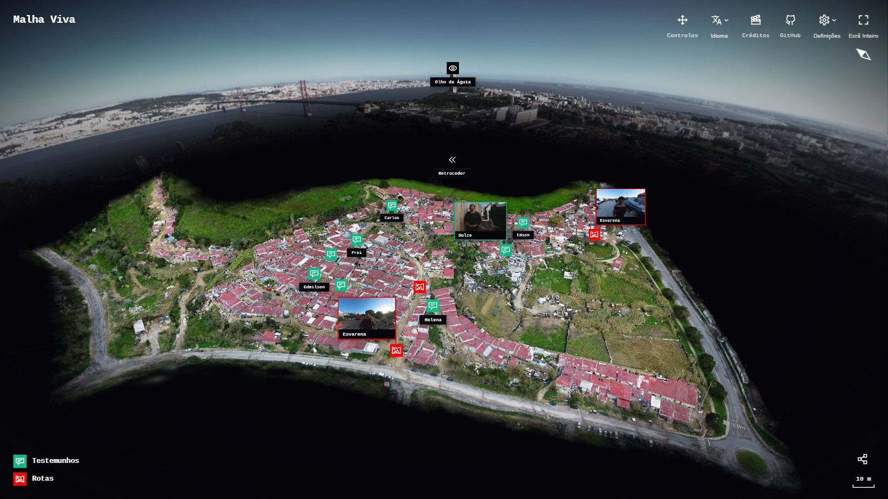
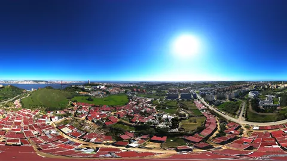
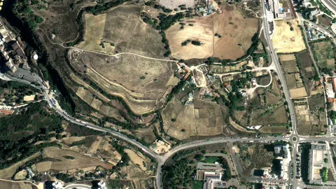

# Malha Viva

**Um webdocumapa do Bairro de Penajóia**, um bairro autoconstruído no Pragal,
em Almada, que não aparece nos mapas.

[**malhaviva.pt**](https://malhaviva.pt) · [Créditos](https://malhaviva.pt/creditos) · [Controlos](https://malhaviva.pt/controlos) · [Licença](LICENSE.md)



> *I am the cinema-eye. I am a constructor.*
> — Dziga Vertov, 1923

---

## O que é

A Área Metropolitana de Lisboa vive uma crise habitacional que não vem só da
falta de casas: vem também do capital excedente que procura no imobiliário um
sítio onde render, e que empurra as casas para fora do alcance de quem
trabalha. Dessa crise nasceram bairros de ocupação urbana, construídos pelos
próprios moradores. O Bairro de Penajóia é um dos maiores: casas de alvenaria
erguidas por pedreiros experientes num terreno do IHRU, com uma associação de
moradores que luta todos os dias contra a demolição e pelo acesso oficial à
eletricidade, à água canalizada e ao saneamento.

Nos mapas da internet, onde está o bairro há um vazio — sem casas, sem ruas,
sem nomes. O **Malha Viva** faz o mapa que falta: um modelo 3D do bairro,
construído a partir de 486 fotografias aéreas de drone, que se percorre no
navegador como quem o sobrevoa. Espalhados por ele estão:

- **os testemunhos** dos moradores, que contam o bairro pelas suas próprias
  palavras, contra as narrativas que o mostram como miséria ou marginalidade;
- **três rotas em vídeo 360º**, a caminhar pelo bairro com Esvarena de Sousa,
  moradora, que leva quem vê pelas ruas que construíram — e a vista vai
  sempre atrás da cara dela;
- **o Olho de Águia**, uma panorâmica aérea a dar a volta inteira ao bairro;
- **Retroceder**, as fotografias de satélite do terreno de 2009 até hoje, a
  passar umas atrás das outras: o bairro a nascer.

Abre em qualquer navegador, no telemóvel ou no computador, sem nada para
instalar, em português, inglês, espanhol e kriolu.

| | | |
|:-:|:-:|:-:|
|  |  |  |
| Olho de Águia | Rotas 360º, com Esvarena | Retroceder |

---

## O objetivo: a obra de arte reproduzível

O Malha Viva quer chegar ao que o construtivismo soviético procurou: uma obra
de arte que não é um objeto único, feito para ser contemplado e guardado, mas
uma **construção** — feita para servir, para ser usada por quem dela precisa,
e para ser **reproduzida** como se reproduz qualquer coisa útil. O artista
deixa de ser o autor de uma obra-prima e passa a ser um construtor.

### Construir, não contemplar

Dziga Vertov apresentava-se assim — *um construtor* — e tratava a câmara como
uma invenção do capitalismo que devia ser apropriada e virada ao contrário,
posta ao serviço de quem trabalha. Para Vertov o cinema tinha de ser útil: em
*O Homem da Câmara de Filmar* (1929) filmou a cidade não como cenário, mas
como obra coletiva, a *oeuvre* de que fala Lefebvre, e montou-a como uma base
de dados de fragmentos, onde quem vê descobre o caminho entre os intervalos.

O Malha Viva segue essa lógica do Cine-Olho, agora no espaço em vez do tempo:
um cinema espacializado, sem ordem obrigatória, em que o mapa 3D é a interface
para os fragmentos filmados e quem vê compõe a sua própria montagem. E quer
ser útil como Vertov queria: pôr no mapa o que o mapa apaga, e dar aos
moradores um lugar para as suas contranarrativas — o direito à cidade
(Lefebvre) e o direito a olhar (Mirzoeff).

### O autor como produtor

Em *O Autor como Produtor* (1934), Walter Benjamin afirma que uma obra não é
política por aquilo que diz, mas por aquilo que muda no **aparelho de
produção**. O seu exemplo é soviético: Sergei Tretiakov, o escritor operante,
que viveu numa comuna agrícola, organizou comícios e levou para lá o rádio e
o cinema. A obra que só carrega uma ideologia subversiva acaba absorvida e
vendida; a que muda a forma de produzir, e transforma o público em
colaborador, não.

É essa a base do método do Malha Viva: um documentário **participativo** e
colaborativo, feito *com* a comunidade e não *sobre* ela, contra o cinema
extrativista que recolhe a imagem das periferias para a montar longe delas,
sem elas, e a mostrar longe dali.

### Desviar os instrumentos do poder

O drone, a fotogrametria e o hiper-realismo do *webmapping* são instrumentos
de controlo. Segundo uma moradora, a câmara municipal sobrevoa o bairro com
um drone para vigiar as construções novas. O Malha Viva usa esse mesmo olhar
aéreo, com a
estética neutra dos mapas oficiais como camuflagem, para o contrário: quem
sobrevoa o bairro aqui não o vigia — fica a conhecê-lo, às suas lutas e às
pessoas que o fizeram. É uma tática de contravisualidade, como as de quem, à
maneira de Michel de Certeau, faz *com* os materiais do poder aquilo que o
poder não previu.

### Reproduzível por construção

É aqui que a obra se torna reproduzível. Tal como o *Civil
Counter-Reconnaissance* de Marko Peljhan, que desmontou drones militares e
publicou o modo de os reconstruir com peças ao alcance de qualquer um, o
Malha Viva é de **código aberto**: o código, o método e as ferramentas estão
neste repositório, para que outro bairro possa construir o seu próprio mapa.
A obra não é só o site — é também a planta para o reproduzir, como forma de
combate deslocalizado contra a visualidade do poder.

- **Gratuito e em todo o lado.** Não há bilhete nem sala: o Malha Viva abre em
  qualquer navegador, no telemóvel ou no computador, contra a injustiça
  espacial que fecha a arte nos centros das cidades.
- **Partilhado, não vendido.** A licença
  [CC BY-NC-SA 4.0](LICENSE.md) deixa qualquer pessoa copiar, adaptar e
  refazer a obra, desde que dê o crédito, a mantenha aberta nos mesmos termos
  e não a transforme em mercadoria: o valor que importa é o de uso, não o de
  troca.
- **Feito com ferramentas desviadas.** O site foi desenvolvido com agentes de
  inteligência artificial (Claude Code e Google Antigravity), que permitiram
  construir uma ferramenta à medida em vez de aceitar os limites das
  plataformas de documentário interativo — o que põe ao alcance de outros
  artistas e comunidades fazer o mesmo.

E há uma aposta: por não ter duração fixa e por devolver o espaço que o tempo
do cinema abstraiu, a obra interativa talvez consiga recuperar algo da aura
que Benjamin viu perder-se com a reprodução técnica — sem deixar de ser
reproduzível.

---

## Reproduzir noutro bairro

O caminho que o Malha Viva seguiu, e onde cada parte vive neste repositório:

1. **Primeiro, a comunidade.** Tudo começa por um trabalho feito com os
   moradores — o que filmar, onde, com quem, e o que fica de fora. Algumas
   localizações reais não estão no mapa de propósito.
2. **O mapa.** Fotografias aéreas de drone transformadas num *Gaussian Splat*
   (aqui com o MipMap), desenhado no navegador pelo motor PlayCanvas
   ([`public/splat`](public/splat), [`public/index.html`](public/index.html)),
   com níveis de qualidade para funcionar de um telemóvel modesto a um
   computador potente.
3. **Os testemunhos.** Entrevistas filmadas, guardadas na nuvem em várias
   resoluções ([`public/videos.mjs`](public/videos.mjs)), com legendas em
   português, inglês e espanhol ([`scripts/legendas`](scripts/legendas)).
4. **As rotas 360º.** Filmadas com uma câmara de duas lentes, com o pau
   escondido no ângulo morto da imagem; a direção da cara de quem guia é
   medida filme fora ([`scripts/seguir-a-cara.py`](scripts/seguir-a-cara.py))
   e o leitor ([`public/video360.html`](public/video360.html)) vai atrás dela,
   com a vista de quem vê por cima.
5. **Os pontos no mapa.** Cada testemunho, rota e fotografia é um marcador em
   [`public/annotations.mjs`](public/annotations.mjs), com miniatura
   ([`scripts/gerar-miniaturas.mjs`](scripts/gerar-miniaturas.mjs)) e com as
   regras de acessibilidade de [`AGENTS.md`](AGENTS.md).
6. **Publicar.** O site corre na Cloudflare (Workers e R2), num endereço que
   qualquer pessoa pode abrir.

---

## Correr o site

É preciso o [Bun](https://bun.sh).

```bash
bun install
bun run dev      # abre em http://localhost:8000
bun run deploy   # publica na Cloudflare (precisa de conta e do wrangler ligado)
```

| Pasta | O que tem |
|---|---|
| [`public/`](public) | O site inteiro: o mapa, os leitores de vídeo, as fotografias, as legendas, as traduções |
| [`src/index.ts`](src/index.ts) | O pequeno servidor na Cloudflare |
| [`scripts/`](scripts) | As ferramentas que prepararam o material: miniaturas, legendas, o caminho da cara nas rotas, o céu |
| [`AGENTS.md`](AGENTS.md) | Regras que qualquer alteração tem de cumprir, a começar pela acessibilidade |

**Tecnologia:** [PlayCanvas](https://playcanvas.com) (3D Gaussian Splatting),
[A-Frame](https://aframe.io) (vídeo 360º), Cloudflare Workers e R2.

### Acessibilidade

O bairro é desenhado pela placa gráfica, e um leitor de ecrã não lê imagens.
Por isso cada ponto do mapa tem um nome dito por palavras, nas quatro línguas,
e entra na ordem do teclado — um testemunho que só se alcança com o rato e
com a vista é um testemunho fechado a parte de quem o quer ouvir. As regras
estão em [`AGENTS.md`](AGENTS.md).

---

## Contexto

Trabalho de Projeto do Mestrado em Ciências da Comunicação, área de
especialização em Cinema e Televisão, na NOVA FCSH — Faculdade de Ciências
Sociais e Humanas da Universidade Nova de Lisboa, com orientação científica
de Maria Madalena Miranda (2026). A componente escrita desenvolve a base
conceptual resumida acima.

**Leituras de base:** Walter Benjamin, *O Autor como Produtor* (1934) ·
Dziga Vertov, *Kino-Eye* · Henri Lefebvre, *O Direito à Cidade* (1968) ·
Nicholas Mirzoeff, *The Right to Look* (2011) · Michel de Certeau, *A
Invenção do Cotidiano* (1980) · Lev Manovich, *The Language of New Media*
(2001) · Jonathan Beller, *The Cinematic Mode of Production* (2006) · Ana
Peraica · Bill Nichols · Judith Aston, Sandra Gaudenzi e Mandy Rose, *i-Docs*
(2017).

**Obras de referência:** *Aspen Movie Map* (MIT, 1978) · *Refugee Republic*
(Jan Rothuizen, 2014) · *Saydnaya: Inside a Syrian Torture Prison* (Forensic
Architecture, 2016) · *Nunca é noite no mapa* (Ernesto de Carvalho, 2016).

## Créditos

Produzido e realizado por **Filipe Malveiro**, com os moradores do Bairro de
Penajóia — e com Esvarena de Sousa, que guia as rotas. Orientação científica
de Maria Madalena Miranda. Os créditos completos estão em
[malhaviva.pt/creditos](https://malhaviva.pt/creditos).

> *Ao Bairro de Penajóia, por me provar ser possível construir uma cidade
> comunitária.*

## Licença

© Filipe Malveiro e colaboradores. Os testemunhos, as fotografias, os vídeos,
o modelo 3D, os textos e o código estão sob a licença
[Creative Commons Atribuição-NãoComercial-CompartilhaIgual 4.0](LICENSE.md).

---

### In English

**Malha Viva** is a web documentary map of Bairro de Penajóia, a self-built
neighbourhood in Almada, near Lisbon, that is missing from online maps. It
places residents' testimonies, three 360° walks guided by resident Esvarena
de Sousa, an aerial panorama and satellite images from 2009 to today on a 3D
model of the neighbourhood made from drone photographs, explored in the
browser. Its aim is the reproducible work of art sought by Soviet
Constructivism: not a unique object for contemplation but a construction made
to be used and to be rebuilt — following Walter Benjamin's *The Author as
Producer* and Dziga Vertov's *Kino-Eye*. The code, the method and the tools
are open in this repository, so that another neighbourhood can make its own
map. Licensed under [CC BY-NC-SA 4.0](LICENSE.md).
